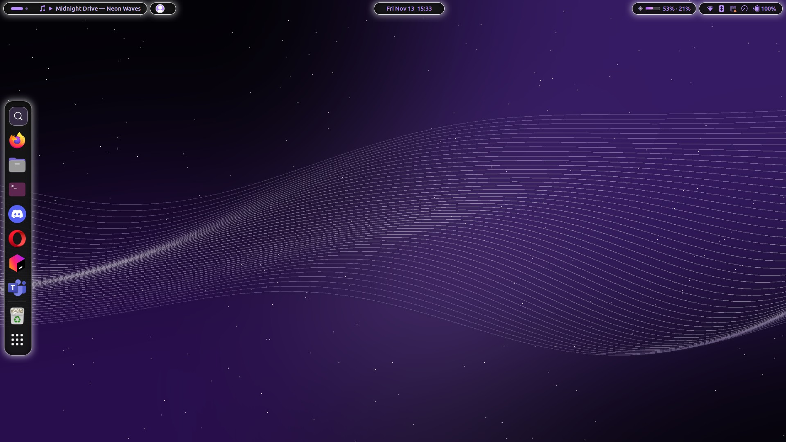
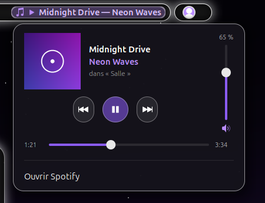
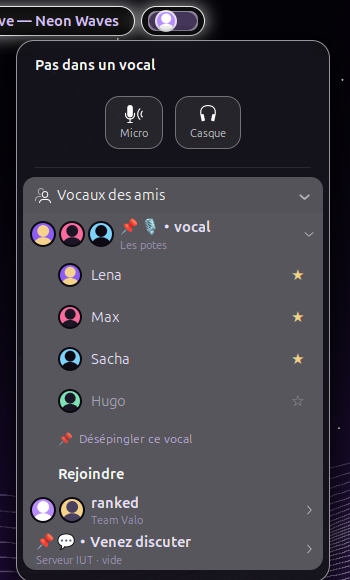
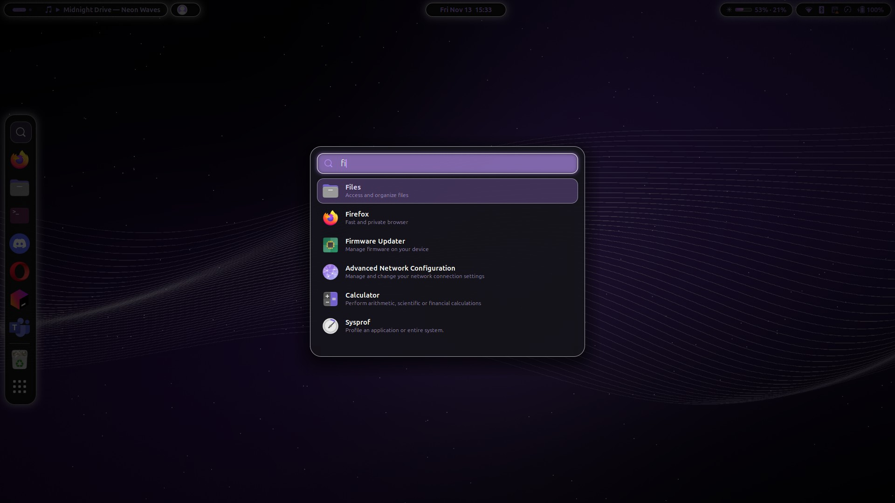

<div align="center">

# 🐧 zecross-rice · Linux

**GNOME en îlots de verre — noir, blanc, violet**




</div>

---

## 📋 Détails

| | |
|---|---|
| **OS** | Ubuntu 24.04 → 26.04 |
| **Bureau** | GNOME Shell 46 → 50 (X11 et Wayland) |
| **Barre** | extension maison `zecross-rice@zecross` — 4 îlots flottants |
| **Dock** | Ubuntu Dock (dash-to-dock) restylé, à gauche, bouton 🔍 |
| **Lanceur** | `zsearch` (Rust) — fautes de frappe, accents, noms FR, frécence |
| **Roue** | [Kando](https://kando.menu) + `zwheel` (clic molette maintenu) |
| **Terminal** | Ptyxis ou GNOME Terminal — palette *Zecross Violet* |
| **Shell** | bash, prompt sur deux lignes `╭─ user • chemin ⎇ branche` / `╰─❯` |
| **Thème GTK / icônes** | Yaru-purple-dark |
| **Curseur** | Bibata Modern Classic |
| **Fond d'écran** | généré par `wallpaper.py` (ou ta rotation Variety, au choix) |

### 🎨 Palette

| Rôle | Couleur |
|---|---|
| Fond des îlots | `rgba(0, 0, 0, 0.86)` |
| Contour + halo | `#ffffff` · `0 0 16px 2px rgba(255,255,255,.6)` |
| Texte / icônes | `#b98cff` |
| Accent fort | `#8b5cf6` |
| Fond terminal | `#0d0a14` |
| Texte terminal | `#ece4ff` |

---

## ✨ Ce qu'il y a dedans

### Barre du haut en îlots
Quatre pilules « verre » (fond noir, contour blanc, halo) : **Activités + Spotify + Discord**, **horloge**, **utilisation Claude**, **icônes système**.

<table>
<tr>
<td width="50%" valign="top">

**🎵 Spotify**
- titre — artiste dans la barre
- au clic : pochette, playlist en cours, ⏮ ⏯ ⏭
- **volume de Spotify seul**, en barre verticale à droite
- **barre de progression** : clic ou glisser pour avancer / reculer

</td>
<td width="50%"></td>
</tr>
<tr>
<td width="50%" valign="top">

**🎧 Discord** (RPC local, ton app, aucun bot)
- ta photo de profil ; en vocal : salon + avatars (anneau violet = parle)
- Micro / Casque / Quitter, **📌 épingler le vocal en cours**
- **Vocaux des amis** : seuls les vocaux où tes amis sont présents, avec leurs pdp
- clic sur un vocal → pseudos, **☆ ami**, **📌 épingler**, **Rejoindre**
- vocaux épinglés toujours visibles, même vides

</td>
<td width="50%"></td>
</tr>
</table>

**🤖 Claude** — utilisation 5 h et hebdo (lit `~/.claude/.credentials.json`, jamais copié), jauges violettes → rose → rouge.

### Recherche d'applis



`Super+F` ou 🔍 du dock. Moteur `zsearch` en Rust : tolère les fautes, ignore les accents, comprend les noms français, apprend ce que tu lances le plus.

### Roue Kando
Clic molette **maintenu** (un clic court garde son rôle : coller, nouvel onglet) ou `Super+W`.
- applis (s'ouvrent sur l'écran où tu as ouvert la roue)
- **JetBrains** ▸ RustRover · IntelliJ · Android Studio · Toolbox (réveillée en ~0,15 s)
- **Git** : dépôt de la fenêtre active → **GitHub ou GitLab** (instances détectées toutes seules) ; PR/MR ouverte, sinon la branche courante ; ouvert dans ton navigateur, mis au premier plan
- **Spotify** ▸ lecture, titres likés, titre au hasard, tes playlists

### Le reste
- **Sélecteur de terminaux** `Super+Espace` : aperçus en direct, `Ctrl+Entrée` = nouveau terminal
- **Alt+Tab** au même style
- **Fenêtres** à coins arrondis (shader), espace sous la barre / en bas / à droite
- **Audio Bluetooth** : le casque reste en mode musique quand tu rejoins un vocal (micro du PC)

---

## ⌨️ Raccourcis

| Touche | Action |
|---|---|
| `Super` + `F` | recherche d'applis |
| `Super` + `Espace` | sélecteur de terminaux |
| `Super` + `W` | roue Kando |
| clic molette maintenu | roue Kando |
| `Alt` + `Tab` | fenêtres (style zecross) |

---

## 📦 Installation

```bash
git clone git@github.com:zecross-dev/zecross-rice.git ~/zecross-rice
cd ~/zecross-rice
./install.sh            # tout sauf la roue
./install.sh --kando    # + roue Kando (et zwheel)
```

**Prérequis** : Ubuntu + GNOME, `python3`, `curl`, `rsync`, `unzip`.
**Recommandé** : Rust (`rustup`) pour `zsearch` / `zwheel`, `python3-pil` pour le fond d'écran, `gh` pour le bouton Git.

Puis : **X11** → `Alt+F2`, `r`, Entrée · **Wayland** → se déconnecter / reconnecter.

> `install.sh` demande `sudo` deux fois sous Wayland : règle udev de `zwheel` (lecture de la souris)
> et règle udev Bluetooth (pas de mise en veille de la puce).

**Retour arrière** : `./restaurer.sh` (réglages sauvegardés dans `backup/` à chaque installation).

### Après l'installation

<details>
<summary><b>Discord</b> — vocaux dans la barre</summary>

1. <https://discord.com/developers/applications> → **New Application**
2. **OAuth2** → redirection `http://localhost` → copie **Client ID** et **Client Secret**
3. `zdiscord setup` (secret demandé au clavier) puis `zdiscord login` et accepte dans Discord

Config, jetons, amis (☆) et vocaux épinglés (📌) : `~/.config/zdiscord/` (droits 600), jamais dans le dépôt.
Discord ne donne pas la liste d'amis aux apps non validées : on les marque d'une ☆ dans le menu.
</details>

<details>
<summary><b>Bouton Git</b> — GitLab privé, navigateur</summary>

- navigateur : `~/.config/zgithub/browser` (ex. `opera`)
- GitLab privé : jeton `read_api` dans `~/.config/zgithub/gitlab-tokens` (`hôte jeton`, droits 600) ou `glab`
- instance GitLab non détectée : son hôte dans `~/.config/zgithub/gitlab-hosts`
- dernière détection : `~/.cache/zgithub/last.log`
</details>

<details>
<summary><b>Spotify</b> — playlists dans la roue</summary>

- sans compte développeur : `zspot add <lien de playlist>`
- avec l'API (playlists automatiques + titre au hasard parmi les likés) : app sur
  <https://developer.spotify.com/dashboard> (Redirect URI `http://127.0.0.1:8888/callback`), puis
  `zspot setup <client_id>` et `zspot login`
</details>

<details>
<summary><b>Terminal</b> — défilement dans Claude Code</summary>

La barre de défilement est toujours visible. Pour qu'elle marche dans Claude Code : `/tui default`
(ou `"tui": "default"` dans `~/.claude/settings.json`). En plein écran, seuls `PgUp` / `PgDn` font défiler.
</details>

---

## 🧩 Compatibilité

| | |
|---|---|
| GNOME 46, X11 (Ubuntu 24.04) | ✅ testé |
| GNOME 50, Wayland (Ubuntu récente, Ptyxis) | ✅ testé |
| GNOME 47 → 49 | ⚠️ déclaré, non testé |
| Clic molette sous Wayland | ✅ `zwheel` en mode evdev/uinput (règle udev) |

Un souci ? `journalctl --user -b | grep -i zecross`

---

## 🗂️ Arborescence

```
gnome-extension/zecross-rice@zecross/   extension (extension.js = chargeur à chaud, core.js = code, stylesheet.css)
zsearch/  zwheel/                        sources Rust (lanceur, roue au clic molette)
bin/                                     zgithub, zlaunch, zspot, zspotify, zdiscord, zkando-icons, kando
kando/                                   menu de la roue (modèle), thème, playlists
dconf/                                   dock / thème / raccourcis, profils terminal (GNOME Terminal, Ptyxis)
pipewire/                                audio Bluetooth (WirePlumber, udev)
shell/bashrc-prompt.sh                   prompt
wallpaper.py                             fond d'écran généré
assets/linux/                            captures de ce fichier
```

<div align="center">

[⬅ retour](README.md) · [🪟 version Windows](WINDOWS.md)

</div>
