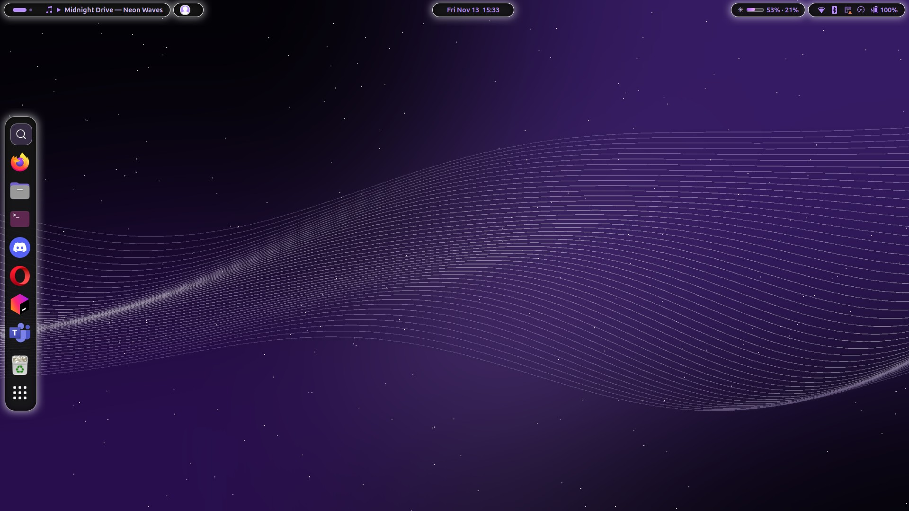

<div align="center">

# zecross-rice

**Rice noir · blanc · violet en îlots de verre — Linux & Windows**



| 🐧 [**Linux**](linux/README.md) | 🪟 [**Windows**](windows/README.md) |
|:---:|:---:|
| GNOME 46 → 50 · X11 & Wayland | Windows 11 |
| ✅ complet | 🚧 en cours |

</div>

---

## L'idée

Une barre du haut éclatée en **îlots flottants** (fond noir, contour blanc, halo), un **dock vertical**
du même style, une **roue** au clic molette pour tout lancer, et des widgets qui servent vraiment :
Spotify, vocaux Discord des amis, utilisation de Claude.

| | |
|---|---|
| 🎵 **Spotify** | pochette, ⏮ ⏯ ⏭, volume vertical, barre de progression cliquable |
| 🎧 **Discord** | vocaux où sont tes amis, pdp, ☆ amis, 📌 vocaux épinglés, rejoindre en un clic |
| 🤖 **Claude** | utilisation 5 h / hebdo |
| 🔍 **Lanceur** | tolère les fautes, ignore les accents, apprend tes habitudes |
| 🛞 **Roue Kando** | applis, JetBrains, bouton Git (GitHub / GitLab : PR, MR ou branche), Spotify |
| 🖥️ **Terminal** | palette *Zecross Violet*, prompt sur deux lignes, sélecteur `Super/Win+Espace` |

## Installation rapide (Linux)

```bash
git clone git@github.com:zecross-dev/zecross-rice.git ~/zecross-rice
cd ~/zecross-rice && ./install.sh --kando     # lance linux/install.sh
```

Tout le détail : [linux/README.md](linux/README.md) · Windows : [windows/README.md](windows/README.md)

## Organisation (dotfiles)

```
linux/
├── home/          paquets dotfiles (format GNU Stow) : chaque paquet reproduit $HOME
│   ├── bin/           .local/bin/  zgithub, zlaunch, zdiscord, zspot…
│   ├── gnome-shell/   .local/share/gnome-shell/extensions/zecross-rice@zecross/
│   ├── bash/          .config/zecross/bashrc-prompt.sh
│   ├── ptyxis/        .local/share/org.gnome.Ptyxis/palettes/
│   └── wireplumber/   .config/wireplumber/wireplumber.conf.d/
├── system/        fichiers système (reproduit /) : règles udev, copiées avec sudo
├── setup/         ce qui ne se lie pas : réglages dconf, modèles Kando, wallpaper.py
├── src/           sources Rust : zsearch (lanceur), zwheel (roue au clic molette)
├── install.sh     liens + compilation + réglages   (--links : juste les liens)
└── restaurer.sh   retour arrière
windows/           version Windows (en cours)
assets/            captures
```

Les dotfiles sont **liés**, pas copiés : modifier sa config, c'est modifier le dépôt.
Avec GNU Stow : `stow -d linux/home -t ~ --no-folding bin gnome-shell bash ptyxis wireplumber`.
